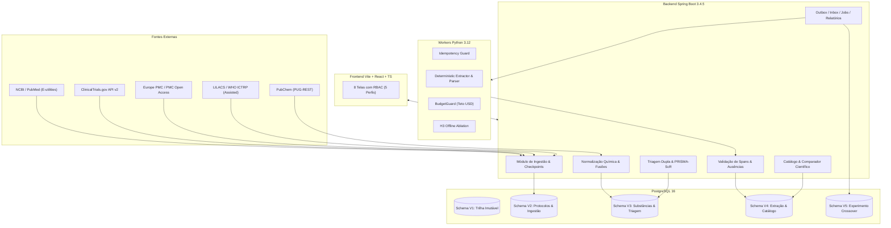

# DenguePharma — Plataforma Auditável de Evidências Farmacológicas para Dengue

> **Aviso Institucional e Científico (Seção 16 / RC-02 / RC-04):**  
> O **DenguePharma** é uma plataforma acadêmica e tecnológica desenhada exclusivamente para **pesquisa científica, síntese de evidências em revisão de escopo (PRISMA-ScR) e curadoria metodológica**.  
> **A plataforma NÃO realiza diagnóstico clínico, NÃO prescreve medicamentos, NÃO calcula dosagens e NÃO gera rankings automáticos de "melhor fármaco"**.

---

## 📑 Sumário Executivo

A dengue é uma das arboviroses de maior impacto na saúde pública global, historicamente carente de terapias antivirais específicas aprovadas com eficácia robusta em desfechos clínicos graves. A literatura científica sobre reposicionamento e desenvolvimento de novos fármacos para dengue é heterogênea, dispersa e frequentemente suscetível a vieses metodológicos (como extrapolar resultados *in vitro* para eficácia clínica, ou confundir desfechos virológicos substitutos com redução de mortalidade).

O **DenguePharma** resolve essa lacuna implementando uma infraestrutura de dados auditável, versionada e imutável que combina:
1. **Governança Científica Rigorosa:** Aplicação automática das 7 regras científicas essenciais (**RC-01 a RC-07**).
2. **Pipelines de Coleta Confiável:** Conectores programáticos com controle de cota (*rate limiting*), *checkpoint* de retomada e proteção contra duplicação de estudos (**RF-01, RF-02**).
3. **Química Computacional Integrada:** Normalização de substâncias pelo PubChem PUG-REST distinguindo monoterapias de combinações fixas (**RF-03**).
4. **Triagem Independente e Rastreabilidade PRISMA-ScR:** Dupla triagem cega com adjudicação formal obrigatória (**RF-04**).
5. **Extração Estruturada com Suporte Literal (Evidence Spans):** Nenhum dado é publicado sem apontar o trecho exato do texto com localização em caracteres, distinguindo estados de ausência e neutralizando tentativas de *prompt injection* (**RF-05, RF-06, T4, T5, T10**).
6. **Catálogo e Comparador Metodológico:** Filtros que nunca escondem limitações e comparação que evidencia incompatibilidades metodológicas sem ranqueamento (**RF-07, RF-08**).
7. **Reprodutibilidade e Licenciamento:** *Snapshots* imutáveis para relatórios em PDF/CSV/JSON e pacotes de reprodução científica que respeitam direitos autorais de artigos com acesso restrito (**RF-09 a RF-12, T6 a T9**).
8. **Avaliação Experimental Crossover A/B/C:** Módulo completo de pesquisa experimental com partição 25/25/50 por família de estudo, ablação offline H3, cronometragem de sessões com pausas e cálculo de Kappa de Cohen (**Seções 14 a 20 / E1 a E6**).

---

## 🏛️ Arquitetura do Sistema

O projeto é estruturado como um monorepo modular em 3 camadas complementares:

```
DenguePharma/
├── backend/          # API REST corporativa (Java 21, Spring Boot 3.4.5, PostgreSQL 16, Flyway)
├── frontend/         # SPA reativa e acessível (React 18, Vite, TypeScript)
├── workers/          # Workers determinísticos e IA (Python 3.12, Pytest)
├── docker-compose.yml# Infraestrutura containerizada (PostgreSQL 16, RabbitMQ, MinIO)
└── .env.example      # Dicionário de variáveis de ambiente
```



---

## 🛡️ Regras Científicas Invioláveis (RC-01 a RC-07)

As regras científicas foram codificadas no nível mais profundo da aplicação (inclusive com *constraints* no PostgreSQL e interceptores lógicos):

| Regra | Nome | Descrição e Implementação |
| :--- | :--- | :--- |
| **RC-01** | **Separação Rígida de Contextos** | É proibido misturar dados *in vitro*, *in silico*, animais e ensaios clínicos humanos. O comparador e o catálogo exigem visualização segregada de finalidade (*Tratamento Antiviral*, *Terapia Dirigida ao Hospedeiro*, *Profilaxia*, *Desafio Humano Controlado* e *Manejo Sintomático*). |
| **RC-02** | **Rigor em Alegações Regulatórias** | A alegação de que um fármaco é aprovado exige validação da *constraint* `chk_regulatory_claim`: autoridade (ex.: ANVISA, FDA), jurisdição territorial, indicação formalmente aprovada, fonte documental e data. Na ausência de qualquer um, o status é forçado para `CANDIDATO_EM_PESQUISA`. |
| **RC-03** | **Desfecho Substituto != Desfecho Clínico** | Redução de viremia plasmática (AUC de RNA viral) não é equivalente nem garantia de redução de hospitalização ou choque por dengue. Além disso, a ausência de relato de eventos adversos (`AUSENCIA_DE_RELATO`) é estritamente impedida de ser exibida como atestado de "segurança". |
| **RC-04** | **Vedação de Ranking Universal** | A plataforma rejeita explicitamente a criação de scores agregados ponderados ou ranqueamentos clínicos de eficácia de medicamentos, impedindo leituras simplistas sobre fármacos em fases iniciais. |
| **RC-05** | **Aplicação Restrita de RoB 2** | A ferramenta RoB 2 só pode ser aplicada a ensaios clínicos randomizados (`chk_rob2_design`). Desenhos observacionais ou pré-clínicos devem utilizar ferramentas adequadas (ROBINS-I ou declaração de não aplicabilidade). |
| **RC-06** | **Tratamento de Retratações Científicas** | Quando um estudo é retratado pelo periódico, ele é **imediatamente removido do catálogo público e do comparador**, enquanto sua versão e histórico documental permanecem integralmente preservados para fins de auditoria histórica, enfileirando uma reavaliação. |
| **RC-07** | **Síntese Descritiva e Transparência** | O MVP entrega mapas descritivos e tabelas estruturadas de evidência. Meta-análises quantitativas automatizadas não são permitidas sem avaliação prévia de homogeneidade metodológica. |

---

## 🧪 Cenários de Teste de Aceite Automatizados (T1 a T10)

Todos os cenários mínimos da **Seção 18** da proposta estão cobertos por testes automatizados contínuos:

- **T1. Reimportação sem Duplicação:** Reexecutar a mesma busca do PubMed ou ClinicalTrials.gov atualiza metadados sem duplicar entidades de estudo ou documentos (`ImportIntegrationTest`).
- **T2. Não Sobrescrever Decisão:** Uma nova versão do documento-fonte reabre curadoria e cria nova versão imutável, mas não apaga a decisão humana anterior (`ImportIntegrationTest`).
- **T3. Vínculo Reversível vs Fusão Automática:** Identificadores compartilhados (mesmo DOI ou NCT) geram propostas de fusão auditadas (`study_link_proposal`), exigindo aprovação manual e permitindo desfazimento completo (`SubstanceAndScreeningIntegrationTest`).
- **T4. Abstenção quando Falta Trecho Literal:** Se um modelo extrai uma informação sem trecho literal comprovado no texto, o status é alterado obrigatoriamente para `INCERTO` e a publicação é bloqueada (`test_extractor.py`).
- **T5. Validação Numérica e Denominadores:** Frações com numerador maior que denominador (ex.: 30/25) ou tamanhos de amostra inconsistentes são invalidados (`test_extractor.py`).
- **T6. Retratação Invalida Síntese Vigente:** A retratação desativa o estudo no catálogo e comparador, mantendo relatórios gerados anteriormente reproduzíveis (`ExtractionCatalogReportOpsIntegrationTest`).
- **T7. Idempotência na Reentrega:** Eventos reentregues na Inbox não geram extrações lógicas duplicadas (`test_idempotency.py`).
- **T8. Exportação com Proveniência Completa:** O PDF exportado é um documento estruturado contendo obrigatoriamente fonte, data UTC, contexto experimental, filtros, status da evidência e limitações (`ExtractionCatalogReportOpsIntegrationTest`).
- **T9. Respeito às Licenças de Redistribuição:** O pacote de reprodução científica exporta textos integrais apenas de artigos com licença aberta (ex.: CC-BY, CC0); artigos restritos têm apenas seus identificadores e hashes SHA-256 exportados (`ExtractionCatalogReportOpsIntegrationTest`).
- **T10. Neutralização de Prompt Injection:** Instruções maliciosas embutidas em resumos ou tabelas de artigos são tratadas como dado textual passivo, sendo expurgadas antes de qualquer processamento (`test_extractor.py`).

---

## 💻 As 8 Telas do Frontend (Vite + React + TS)

A interface é responsiva, segue princípios de acessibilidade (navegação integral por teclado e rótulos sem dependência exclusiva de cor) e possui controle granular de acesso (RBAC) com 5 papéis: `LEITOR`, `REVISOR`, `ADJUDICADOR`, `PESQUISADOR` e `ADMINISTRADOR`.

1. **Protocolos (`/protocolos`):** Cadastro de protocolos de revisão de escopo, estratégia de busca, critérios de inclusão/exclusão e ciclo de vida (`DRAFT` -> `REGISTERED` -> `FROZEN`).
2. **Importações (`/importacoes`):** Execução de buscas em tempo real, monitoramento de progresso com *checkpoints*, contadores de registros novos/atualizados e logs de quota.
3. **Triagem (`/triagem`):** Triagem cega independente de títulos e resumos por dois revisores, tela de adjudicação para resolução de divergências e fluxograma **PRISMA-ScR** gerado dinamicamente.
4. **Revisão Lado a Lado (`/revisao`):** Exibição do valor extraído lado a lado com a citação literal da fonte (`char_start..char_end`), permitindo aprovação, correção com justificativa obrigatória ou rejeição.
5. **Catálogo de Evidências (`/catalogo`):** Navegação e busca multifatorial por substância química, contexto experimental, desenho de estudo, serotipo da dengue e fase clínica, mantendo alertas de segurança e limitações metodológicas em evidência.
6. **Comparador Metodológico (`/comparador`):** Seleção de múltiplos estudos avaliando o mesmo desfecho e janela temporal, destacando incompatibilidades metodológicas e exibindo o aviso legal de vedação a rankings clínicos.
7. **Relatórios (`/relatorios`):** Geração de *snapshots* auditáveis congelados (`report_snapshot`) com download direto nos formatos **PDF**, **CSV** e **JSON**.
8. **Painel Operacional (`/painel`):** Central de controle com fila de reavaliação de fontes, monitoramento de jobs assíncronos com *lease*, publicação da Outbox, partição por famílias de estudo, métricas de concordância (**Kappa**) e exportação do pacote de reprodução.

---

## 🚀 Como Executar o Projeto Localmente

### Pré-requisitos
- **Java Development Kit (JDK) 21**
- **Node.js 18+** e **npm**
- **Python 3.12**
- **Docker Desktop** (com suporte a Docker Compose)
- **Apache Maven 3.9+**

---

### Passo 1: Configurar Variáveis de Ambiente
Copie o arquivo de exemplo e crie o `.env` local:
```powershell
cp .env.example .env
```
O `.env` já vem pré-configurado para desenvolvimento local seguro:
```env
DB_NAME=denguepharma
DB_USER=denguepharma
DB_PASSWORD=denguepharma_local_dev_secret_123
DB_PORT=5434
DB_URL=jdbc:postgresql://localhost:5434/denguepharma
RABBITMQ_USER=denguepharma
RABBITMQ_PASSWORD=denguepharma_local_dev_secret_123
MINIO_USER=denguepharma
MINIO_PASSWORD=denguepharma_local_dev_secret_123

JWT_SECRET=super_secret_jwt_key_with_at_least_32_characters_12345
BOOTSTRAP_ADMIN_EMAIL=admin@denguepharma.org
BOOTSTRAP_ADMIN_PASSWORD=AdminPassword123!
```

---

### Passo 2: Subir a Infraestrutura (Banco de Dados)
Suba o container do PostgreSQL 16:
```powershell
docker compose up -d postgres
```
*(O banco inicializa na porta `5434` do seu computador, evitando conflito caso você já possua outro PostgreSQL na porta padrão 5432).*

---

### Passo 3: Inicializar a API Backend (Spring Boot)
No diretório raiz do projeto:
```powershell
Get-Content .env | ForEach-Object { if ($_ -match '^([^#=]+)=(.*)$') { [System.Environment]::SetEnvironmentVariable($matches[1].Trim(), $matches[2].Trim()) } }
mvn -f backend/pom.xml spring-boot:run
```
A API iniciará em `http://localhost:8080`.

---

### Passo 4: Inicializar a Interface Frontend (React / Vite)
Em um novo terminal:
```powershell
npm install --prefix frontend
npm run dev --prefix frontend
```
Acesse a aplicação no seu navegador em: **`http://localhost:5173`**.

---

### Passo 5: Explorar com o Piloto de 20 Estudos
1. Entre na interface usando:
   - **E-mail:** `admin@denguepharma.org`
   - **Senha:** `AdminPassword123!`
2. Clique na aba **Painel operacional** no menu superior.
3. Clique no botão **"Carregar Piloto de 20 Registros (Seção 20)"**.
4. Imediatamente a base será populada com estudos clássicos e contemporâneos de dengue:
   - *Celgosivir* (Ensaio clínico de fase 2, DENV-1/2);
   - *Balapiravir* (Ensaio clínico randomizado, sem benefício em viremia);
   - *Cloroquina* (Ensaio clínico de fase 3, sem redução de internação);
   - *Ivermectina* (Ensaio de depuração de NS1);
   - *JNJ-1802 / Mosnodivir* (Estudo de desafio humano controlado com DENV-3);
   - *Prednisolona* (Corticoterapia precoce sem prevenção de choque);
   - *Sofosbuvir, Niclosamida, Ribavirina* (Modelos *in vitro* e animais com EC50 explícita);
   - *Sinefungina e Quercetina* (Simulações *in silico* de docking molecular na metiltransferase NS5).
5. Agora explore as abas **Catálogo**, **Comparador**, **Relatórios** e **Triagem** com os dados reais já visualizados e filtráveis!

---

## 🧪 Execução das Suítes de Teste Automatizadas

### 1. Testes de Integração do Backend (Java / Testcontainers)
Testa o fluxo completo do Spring Boot subindo um container isolado do PostgreSQL 16 via Testcontainers:
```powershell
mvn -B -q -f backend/pom.xml test
```
*Total:* **35 testes** passando (autenticação, imutabilidade, regras científicas, T1 a T10 e módulo experimental).

### 2. Testes dos Workers e IA (Python / Pytest)
Testa sanitização contra injeção de prompt, validação de denominadores e frações, cálculo de métricas F1 e ablação offline H3:
```powershell
workers\.venv\Scripts\python.exe -m pytest workers -q
```
*Total:* **9 testes** passando.

### 3. Testes do Frontend e Compilação de Produção (Vitest / Vite)
Testa permissões de rotas, navegação por perfil, formulários e faz a verificação estática de tipos do TypeScript:
```powershell
npm test --prefix frontend -- --run
npm run build --prefix frontend
```
*Total:* **7 testes** passando e compilação de produção sem erros de tipos (`tsc -b`).

---

## 📊 Módulo de Avaliação Experimental e Métricas (Seções 14 a 17)

O sistema possui uma API dedicada para conduzir a validação experimental formal da proposta de pesquisa:

- **Partição por Famílias de Estudo (`POST /api/experiment/split`):** Garante que documentos derivados do mesmo ensaio clínico permaneçam na mesma partição estratificada (**25% DEV**, **25% Validação**, **50% Teste Congelado**).
- **Alocação Crossover Balanceada (`POST /api/experiment/allocate`):** Aloca os documentos entre revisores nas condições **A (Manual)** e **C (Assistida por IA com trecho literal)**, garantindo que o mesmo revisor nunca avalie o mesmo documento em duas condições distintas.
- **Sessões Cronometradas (`POST /api/experiment/sessions`):** Captura o tempo ativo de leitura, tempo de pausas, volume de correções e dificuldade do artigo.
- **Métricas Científicas Consolidadas (`GET /api/experiment/metrics`):**
  - **Precisão, Recall e F1** em campos preenchidos, **excluindo verdadeiros negativos de ausência** (evitando inflar artificialmente a acurácia com campos que naturalmente não existiam no artigo);
  - **Acurácia de Ausência Correta:** Avaliação segregada dos status `NOT_REPORTED`, `NOT_APPLICABLE`, `UNCERTAIN` e `CONFLICTING`;
  - **Taxa de Fidelidade:** Proporção de campos onde o trecho citado sustenta factualmente a afirmação clínica sob revisão cega;
  - **Concordância Interobservador:** **Kappa de Cohen** e percentual de acordo na triagem independente antes da adjudicação;
  - **Mediana de Tempo por Condição:** Comparação do tempo gasto na condição manual vs assistida por IA, confrontando com a meta de engenharia de **redução mínima de 20% no tempo de curadoria**.

---

## 📄 Licença e Termos de Uso
Este software é distribuído sob licença acadêmica para fins de pesquisa em saúde pública e informática médica. Dados bibliográficos recuperados de fontes externas permanecem sob os termos de uso e direitos autorais de suas respectivas instituições e periódicos de origem.
